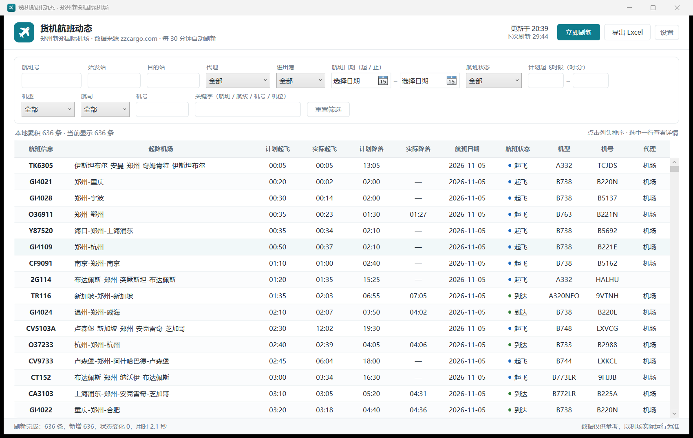
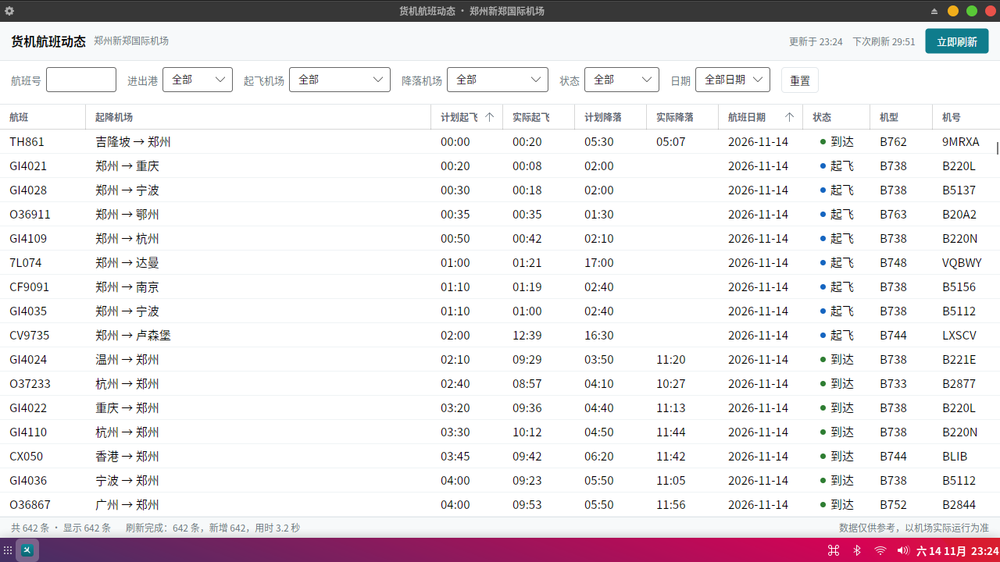

# 货机航班动态 · 郑州新郑国际机场

一个 Windows 桌面小工具：抓取 [郑州机场货运网](https://www.zzcargo.com/airline/1) 的“货机航班动态”，
在本机累积保存，提供筛选、查找、排序、详情查看，并一键导出 Excel（前 9 列对齐 `example.xlsx`）。

> 安卓版（Kotlin）：[ZHCC_Cargo_Flight_Tracker](https://github.com/liwei3699/ZHCC_Cargo_Flight_Tracker)



## 直接使用（不想编译）

1. 取 [Releases](https://github.com/liwei3699/ZHCC_Cargo_Flight_Tracker_for_Windows/releases/latest) 里的 `ZhccCargoBoard_win-x64_v1.0.1.zip`（或本地 `dist\货机航班动态_免安装版.zip`），解压到**普通文件夹**（桌面、`D:\Apps` 等，不要放在带低完整性标记的目录）；
2. 双击 `货机航班动态.exe`，首次启动自动抓取一次，之后每 30 分钟刷新；
3. 关闭窗口即最小化到托盘 `^` 后台刷新，托盘菜单里退出。详细说明见 [使用说明.txt](使用说明.txt)。

## 功能

- **抓取**：一次抓全站 58 页 / 600+ 条，6 路并发，约 2~5 秒；自动校验 `sum(records) == total`，不一致自动重抓。
- **累积**：SQLite 本地库，主键 `ffid`，按内容指纹判断变化，记录 `first_seen / last_seen / change_count`，按保留天数清理。
- **刷新**：默认 30 分钟自动刷新（可调 1~1440），支持手动刷新、取消、失败退避重试；关闭窗口进托盘后台刷新。
- **筛选**：航班号、始发站、目的站、代理、进出港、航班日期区间、航班状态、计划起飞时段、机型、航司、机号、全局关键字；列头点击排序。
- **详情**：选中行右侧抽屉显示机位、航站楼、航班任务、异常信息、首次/最近记录时间。
- **导出**：基础 9 列 + 可选 10 个附加列；范围可选当前筛选 / 全部 / 指定日期；时间写成真正的 Excel 时间，日期写成真正的日期；冻结首行 + 自动筛选。

## 技术栈

- .NET 10 / C# / WPF（`net10.0-windows`），MVVM-lite
- `Microsoft.Data.Sqlite`（本地库）、`ClosedXML`（导出 xlsx）
- `System.Windows.Forms.NotifyIcon`（托盘）
- 发布为 **win-x64 自包含文件夹版**：目标机器无需安装 .NET，解压即用。单文件版需要一个可写的临时目录来做原生库解包，受限环境下会静默退出，因此改为默认文件夹版（`-SingleFile` 仍可手动出单文件）

## 目录结构

```
docs/
  screenshot.png                # 界面截图
  web-ui-reference.jpg          # 数据来源网页（zzcargo.com/airline/1）原貌，参考用
sample/
  货机航班动态_示例.xlsx          # 导出样例（636 行，9 列）
example.xlsx                    # 需求方给的导出格式基准，前 9 列与之对齐
src/
  ZhccCargoBoard.Core/          # 模型、抓取、存储、导出（无 UI 依赖）
    Models/FlightRecord.cs
    Services/ZzcargoClient.cs   # POST /flightDynamic/skipTo，多页并发
    Storage/FlightStore.cs      # SQLite 建表 / UPSERT / 统计 / 清理
    Export/ExportColumns.cs     # 9 基础列 + 10 附加列定义
    Export/XlsxExporter.cs      # ClosedXML 导出
    AppPaths.cs AppSettings.cs Log.cs
  ZhccCargoBoard.App/           # WPF 界面（Windows）
    MainWindow.xaml(.cs) ViewModels/MainViewModel.cs
    Dialogs/ExportDialog.xaml(.cs) Dialogs/SettingsDialog.xaml(.cs)
    Services/TrayService.cs Converters/Converters.cs App.xaml(.cs)
  ZhccCargoBoard.Desktop/       # Avalonia 界面（Linux / Orange Pi 5 只读查看器）
    Views/MainWindow.axaml(.cs) Views/DetailWindow.axaml(.cs)
    ViewModels/MainViewModel.cs Assets/app.png
tools/
  ZhccCargoBoard.Cli/           # 命令行验证工具：fetch / export / all / print
  linux/install-on-board.sh     # 板端安装脚本（复制目录 + 建桌面快捷方式）
  make_icon.py                  # 生成 app.ico
tests/                          # 自动化测试（见下）
build.ps1                       # 发布 Windows 文件夹版到 dist\货机航班动态\ 并打 zip
build-linux.ps1                 # 交叉编译 linux-arm64 包（dist-linux\*.tar.gz）
使用说明.txt                     # 给最终用户看的说明
```

## 开发与运行

```powershell
# 还原 + 构建
dotnet build ZhccCargoBoard.slnx

# 调试运行（数据写到 %LOCALAPPDATA%\ZhccCargoBoard）
dotnet run --project src\ZhccCargoBoard.App\ZhccCargoBoard.App.csproj

# 命令行验证：抓取 -> 入库 -> 导出
$env:ZHCC_DATA_DIR = 'D:\tmp\zhcc'
dotnet run --project tools\ZhccCargoBoard.Cli -- all out\check.xlsx
```

## 发布

```powershell
pwsh -File build.ps1                    # 文件夹版 + 免安装 zip（默认）
pwsh -File build.ps1 -SkipZip           # 只出文件夹版，不打包
pwsh -File build.ps1 -SingleFile        # 另外再出一个单文件版（依赖可写 TEMP）
```

产物在 `dist\`：

- `dist\货机航班动态\`：文件夹版（`货机航班动态.exe` + 依赖 dll + `使用说明.txt`），约 167 MB；
- `dist\货机航班动态_免安装版.zip`：上面的目录打包，约 71 MB，**拷给别人用这个**。

> 单文件版的坑：自包含单文件的 apphost 启动时要把 WPF 原生库解包到 `%TEMP%\.net\<程序名>\<hash>`，
> 遇到 TEMP 不可写（受限账号、漫游配置、部分安全软件）就会**静默退出、毫无提示**。
> 文件夹版不做解包，因此没有这个问题。

## Linux / Orange Pi 5（板端查看器）

同一套 `Core` 代码 + Avalonia 前端的只读查看器，已部署在 Orange Pi 5（RK3588S，Ubuntu 22.04，1280x720）：



- 抓取 642 条 / 59 页 / **3.2 秒**；RSS ≈ 261 MB；空闲 CPU ≈ 1.7%（8 核）
- 渲染走 **EGL + Mali GLES**（`libEGL.so.1` + `libmali.so`，无 llvmpipe）
- 无导出、无托盘、不常驻：打开即抓，关闭即退出（`src/ZhccCargoBoard.Desktop`）

```powershell
# Windows 侧交叉编译 arm64 包
pwsh -File build-linux.ps1

# 传到板子并安装（板子在 192.168.170.x，配好免密 SSH）
scp dist-linux\zhcc-board-linux-arm64.tar.gz orangepi@<板子IP>:~/
ssh orangepi@<板子IP> "mkdir -p ~/apps && tar -xzf ~/zhcc-board-linux-arm64.tar.gz -C ~/apps && bash ~/apps/zhcc-board/install-on-board.sh"
```

安装后桌面与开始菜单会出现「货机航班动态」。渲染路径若在某台板子上初始化失败，Avalonia 会自动回退软件渲染。

## 数据源与接口

翻页接口（无需 Cookie，带 `X-Requested-With` / `Referer` / `Origin` / UA 即可）：

```
POST https://www.zzcargo.com/flightDynamic/skipTo?jstime=<毫秒>
Content-Type: application/x-www-form-urlencoded

current=1&flightNo=&execDate=&ioAttr=&agency=&startStationCn=&terminalStationCn=
```

响应：`{"code":200,"data":{"current":1,"pages":58,"total":636,"records":[ ... 68 个字段 ... ]}}`

**IPv6 坑**：`www.zzcargo.com` 有 AAAA 记录但该地址 443 不通，.NET/curl 默认会先连 IPv6 卡满 20 秒。
`ZzcargoClient.CreateDefaultHandler()` 通过 `SocketsHttpHandler.ConnectCallback` 强制 IPv4 优先（每个地址 5 秒超时），
单请求从 21 秒降到 0.5 秒。

## 导出格式

| # | 列名 | 来源字段 | 类型 |
|---|------|----------|------|
| 1 | 航班信息 | `airlinesIataCd + flightNo` | 文本 |
| 2 | 起飞机场 | `startStationCn` | 文本 |
| 3 | 降落机场 | `terminalStationCn` | 文本 |
| 4 | 计划起飞时间 | `scheTakeOffTime` | Excel 时间 `h:mm` |
| 5 | 实际起飞时间 | `actlTakeOffTime` | Excel 时间 `h:mm`（无则空） |
| 6 | 计划降落时间 | `scheLandingTime` | Excel 时间 `h:mm` |
| 7 | 实际降落时间 | `actlLandingTime` | Excel 时间 `h:mm`（无则空） |
| 8 | 航班日期 | `execDate` | Excel 日期（默认 `yyyy-mm-dd`） |
| 9 | 航班状态 | `normalStateCn`（空显示“计划”） | 文本 |

附加列：代理、进出港、区域、机型、机号、航线、机位、航站楼、航班任务、异常。

## 测试

```powershell
pwsh -File tests\run-tests.ps1      # 12 项自检：JSON 映射 / 时间解析 / 指纹 / SQLite 入库清理 / xlsx 格式
```

自检是普通控制台程序（不依赖 xunit / testhost），跑完看退出码即可。
受限环境会把 `TEMP`、`ZHCC_TEST_DIR` 指到工作区 `.localtmp\`。

`tools\capture_window.ps1`：按进程/标题截窗口图（含高 DPI 适配），用于人工核对界面。

## 已知限制

- 网页只展示“今天 ~ 未来 3 天”，更早的历史只有本机长期运行才会留下。
- 列宽未与 `example.xlsx` 逐像素一致（示例 B 列为默认宽会截断长机场名），列名/顺序/类型/格式一致。
- 首次运行若被安全软件拦截，添加信任即可。
- 托盘图标：程序用 WinForms `NotifyIcon` + BMP 帧 ICO 注册。若把程序放在带“低完整性”标记的目录（沙箱、部分安全软件处理过的文件夹）里运行，进程会以 Low IL 启动，`Shell_NotifyIcon` 返回 `ERROR_ACCESS_DENIED(5)`，Windows 会拒绝任何托盘图标；把整个文件夹复制到桌面、`D:\Apps` 等普通目录（进程为 Medium IL）即可正常显示。图标默认收在任务栏 `^` 溢出区。

## 相关文档

- [跨平台移植可行性研究：Ubuntu arm64 / RK3588](docs/porting-ubuntu-arm64.md)
- [板端实施方案：Orange Pi 5 只读查看器](docs/plan-orange-pi5-viewer.md)
- [PLAN.md](PLAN.md)：初版方案与需求确认记录

## 许可

MIT License，见 [LICENSE](LICENSE)。

数据仅供参考，以机场实际运行为准。
